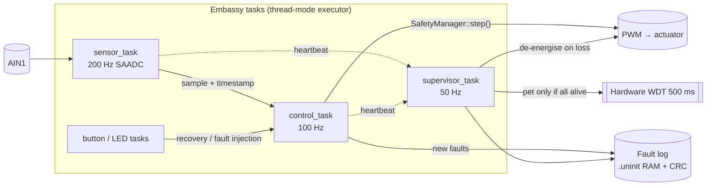
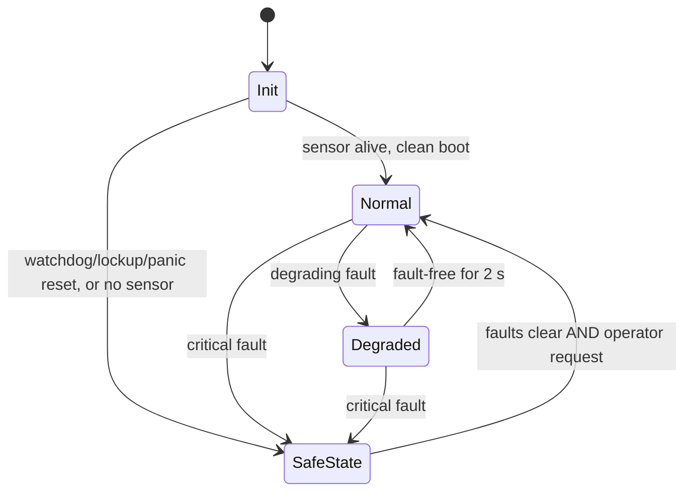

# nrf52-safe-actuator

Fault-tolerant closed-loop actuator controller in embedded Rust, built with
[Embassy](https://embassy.dev) on the nRF52840.

The application is simple on purpose: a PI position loop at 100 Hz. The project is
about everything around that loop. It detects sensor, actuator, timing and software
failures within a known time, degrades or removes actuator authority, supervises
tasks with a hardware watchdog, and keeps post-mortem diagnostics across resets.

All safety decisions live in a `no_std`, HAL-free crate (`safety-core`). The same
code runs on the target and in host-side closed-loop failure-injection tests in CI.

```
safety-core/   no_std safety logic: monitors, persistence filters, state machine,
               PI control, heartbeat supervision, CRC-protected fault log
  tests/       closed-loop failure-injection scenarios against a simulated plant
firmware/      Embassy application for the nRF52840-DK
```

## Architecture



Each control cycle runs the safety manager in a fixed order:

1. **Monitors** evaluate raw conditions: electrical range, sample age, tracking
   error and execution-time overrun.
2. **Persistence filters** confirm a fault after N consecutive bad cycles and clear it
   after M good ones. A single glitch can't trip the system, and every detection time
   has a known bound.
3. The **state machine** picks Normal, Degraded or SafeState from the worst active
   severity.
4. The **output path** applies the authority for that state: reference envelope,
   slew rate and output clamp. In SafeState it de-energises.

## Safety concept

### States



* **SafeState is latched.** The system only leaves it when no fault is active *and*
  an operator has asked for recovery. A request made while a fault is still present
  is refused.
* **Restarting is bumpless.** On re-entry the reference starts at the measured
  position, so the actuator doesn't jump.
* **After an unexpected reset the board starts in SafeState.** A watchdog reset, CPU
  lockup or panic means the last run didn't end under control, so actuation doesn't
  resume on its own.

### Fault table

At 100 Hz, one cycle is 10 ms. Detection bounds are checked by the scenario tests.

| Fault | Detected by | Detection bound | Reaction |
|---|---|---|---|
| Sensor open / short (`SensorOutOfRange`) | raw value outside 0.45–0.95 FS | 3 cycles (30 ms) | SafeState |
| Sensor stuck / no data (`SensorStale`) | sample age > 30 ms | age + 2 cycles (≤ 60 ms) | SafeState |
| Actuator jammed / driver failed (`TrackingError`) | \|ref − pos\| > 0.1 | 30 cycles (300 ms) after threshold | SafeState |
| CPU overload (`DeadlineOverrun`) | cycle execution > 5 ms | 3 cycles | Degraded (≤ 50 % output, slower slew) |
| Task stalled (`HeartbeatLost`) | supervisor heartbeat check | ≤ 70 ms | output cut by supervisor, then watchdog reset |
| Executor blocked / hard fault | hardware watchdog | ≤ 500 ms | reset → boots in SafeState |
| Panic (`PanicReset`) | panic handler | immediate | logged, reset → boots in SafeState |

### Why the sensor signal never reaches 0 V or VDD

The sensor is wired so that a healthy reading always sits between 0.5 and 0.9 of
full scale. A broken wire pulls the input to VDD and a short pulls it to GND. Both
are outside the valid band, so they're detected as faults instead of being read as
valid positions. Industrial 0.5–4.5 V sensors use the same idea.

### Why a hardware watchdog *and* heartbeats

In a cooperative async executor, a task that awaits something that never happens
doesn't crash. It just goes quiet. Each task therefore reports a heartbeat, and the
supervisor only feeds the hardware watchdog while all heartbeats are fresh. When one
is lost, the supervisor de-energises the actuator straight away through its own path
to the driver, without waiting for the control task. If a task blocks the whole
executor, the supervisor can't run either, and the watchdog resets the chip.

### Fault log that survives resets

A 32-entry ring buffer lives in a `.uninit` RAM section that startup code doesn't
zero. It's protected by a magic number, bounds checks and a CRC-32. It survives
watchdog, lockup, panic and soft resets, and is dumped over RTT at boot and when
button 1 is pressed. Records carry the boot number and uptime. Writing to RAM
instead of flash means logging a fault costs no flash wear and no blocking erase
inside the control loop.

## Hardware

**nRF52840-DK** (PCA10056), two 10 kΩ resistors and one 10 µF capacitor.

```
           10k
P1.10 ───/\/\/───┬────────── P0.03 (AIN1)
(PWM)            │
           10k   │
VDD   ───/\/\/───┤
                 │
               ═══ 10 µF
                 │
GND ─────────────┘
```

The RC network stands in for an actuator: a first-order plant with τ = 50 ms whose
"position" is the filtered PWM duty. The divider to VDD gives the offset band
described above. Pull the P0.03 wire to simulate an open sensor, or short it to GND.

| DK resource | Function |
|---|---|
| LED1 | actuator command (brightness) |
| LED2 | state: steady = Normal, slow blink = Degraded, fast blink = SafeState |
| LED3 | a fault injection is active |
| LED4 | actuator de-energised |
| Button 1 | operator recovery request + fault-log dump |
| Button 2 | inject: freeze sensor data (toggle) |
| Button 3 | inject: stall control task |
| Button 4 | inject: control-loop overrun (toggle) |

## Build and run

```sh
# Host: safety logic tests, including failure-injection scenarios
cargo test

# Target
rustup target add thumbv7em-none-eabihf
cargo install probe-rs-tools
cd firmware
cargo run --release                          # flash + RTT logs
cargo build --release --no-default-features  # build without fault-injection hooks
```

## Failure-injection walkthrough

| Action | Expected behaviour |
|---|---|
| Power up | `boot #1 reset=PowerOn ... -> start in Normal`; LED1 follows the triangle reference |
| Button 4 | `DeadlineOverrun` → Degraded (LED2 slow blink, output and envelope limited). Press again → back to Normal 2 s after the fault clears |
| Button 2 | `SensorStale` → SafeState within ~60 ms, LED4 on. Press again to restore data, then Button 1 to recover |
| Disconnect P0.03 | `SensorOutOfRange` → SafeState within 30 ms. Reconnect, then Button 1 |
| Hold the RC node at a fixed voltage | `TrackingError` → SafeState |
| Button 3 | supervisor reports `heartbeat lost: control`, output cut, watchdog reset ~0.5 s later; next boot logs `WatchdogReset` and starts in SafeState |
| Button 1 | prints the fault log; recovers if all faults have cleared |

## Testing

* **Unit tests** cover each building block: persistence filter, state machine
  transitions, PI anti-windup, rate limiter, heartbeat monitor, fault-log ring buffer,
  CRC and corruption handling.
* **Closed-loop scenarios** (`safety-core/tests/fault_injection.rs`) run the real
  `SafetyManager` against a simulated plant that matches the hardware, inject one
  failure per test, and check both the reaction and its detection bound. In every
  cycle they also check two invariants: the output is never energised outside
  Normal/Degraded, and degraded authority is never exceeded.
* **CI** runs rustfmt, clippy (`-D warnings`) and the host tests, checks that
  `safety-core` builds for `thumbv7em-none-eabihf`, and builds the firmware with and
  without fault injection.

## Design decisions

* **Keep the safety logic separate from the HAL.** All decisions are pure functions
  of inputs and time, so they can be tested deterministically on the host. The
  firmware only does I/O, timing and wiring. `safety-core` uses
  `#![forbid(unsafe_code)]`.
* **Make every detection time bounded.** Persistence filters filter out noise while
  keeping a known worst-case detection latency for each fault.
* **Use independent shutdown paths.** The normal path is the control loop
  commanding zero output. The supervisor path cuts the actuator directly. The last
  resort is a watchdog reset, after which the pins return to their reset state.
* **Require an operator to leave SafeState.** Automatic recovery is only allowed for
  degrading faults.

## Limitations and next steps

This is a demonstrator, not a certified product. Natural next steps:

* Copy the fault log to flash (e.g. `sequential-storage`) so it also survives power
  loss.
* Use a hardware-in-the-loop rig (a second MCU or a Raspberry Pi Pico driving the
  sensor line) to automate the failure-injection walkthrough on real hardware.
* Measure worst-case cycle time and stack use, and add a stack-overflow guard via
  the MPU.
* Add a CAN or UART command interface with message CRC and timeout monitoring.

## License

MIT. See [LICENSE](LICENSE).
